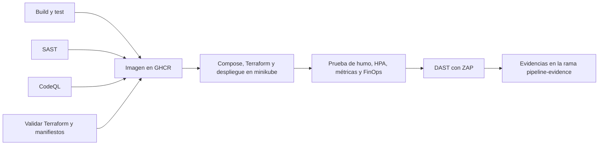
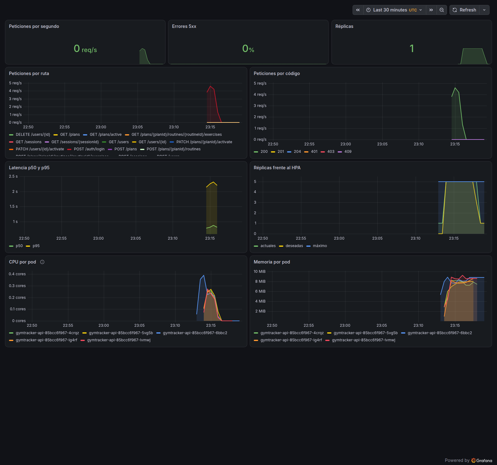
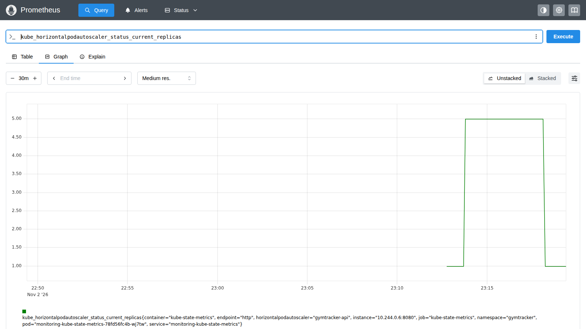
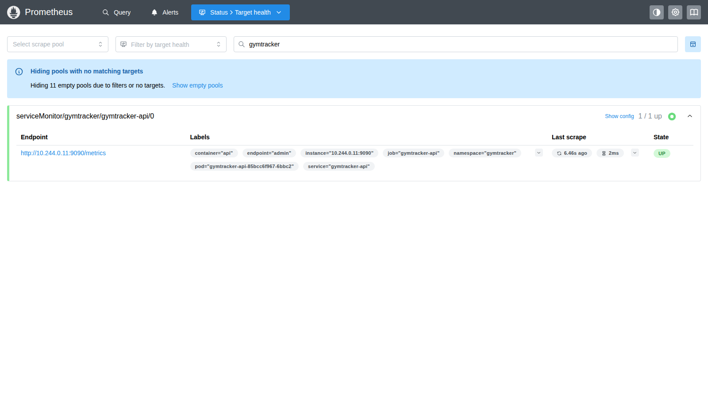

# GymTracker API

A REST API for tracking gym workouts, built with Go. It deploys as serverless functions with AWS CDK, or as a container on Kubernetes.

## 🚢 Pipeline DevOps (contenedores y Kubernetes)

Además del despliegue serverless, la API corre como un solo proceso HTTP en un contenedor, con un pipeline completo en GitHub Actions: pruebas, análisis de seguridad, imagen, Terraform, despliegue en Kubernetes, DAST y evidencias.

Los dos despliegues comparten la lógica de negocio y no se afectan entre sí:

| | Serverless (producción) | Kubernetes (pruebas) |
|---|---|---|
| **Cómputo** | AWS Lambda | Pods en minikube |
| **Entrada** | [`cmd/{auth,user,plan,session,authorizer}`](cmd/) | [`cmd/server`](cmd/server/main.go) |
| **Infraestructura** | AWS CDK ([`infra/`](infra/)) | Terraform ([`terraform/`](terraform/)) y Kustomize ([`deploy/k8s/`](deploy/k8s/)) |
| **Base de datos** | DynamoDB `gym-tracker` | DynamoDB Local, en memoria |
| **Workflow** | [`deploy.yml`](.github/workflows/deploy.yml) | [`pipeline.yml`](.github/workflows/pipeline.yml) |
| **Costo** | Según uso en AWS | Ninguno |

### Qué hay en el repositorio

| Ruta | Contenido |
|---|---|
| [`Dockerfile`](Dockerfile), [`compose.yaml`](compose.yaml) | Imagen multi-stage distroless sin root y pila local |
| [`internal/httpapi/`](internal/httpapi/) | Adaptador HTTP sobre los routers de Lambda, con métricas y health checks |
| [`terraform/environments/local`](terraform/environments/local/main.tf) | metrics-server, Traefik, Prometheus y Grafana sobre un clúster existente. **Se aplica en cada ejecución** |
| [`terraform/environments/aws`](terraform/environments/aws/main.tf) | VPC, EKS, ECR y DynamoDB. **Nunca se ha aplicado**: solo se valida y se prueba con proveedores simulados |
| [`deploy/k8s/base`](deploy/k8s/base/) | Deployment, Service, Ingress, HPA, PDB, NetworkPolicy, cuota, ServiceMonitor y alertas |
| [`deploy/k8s/components/finops`](deploy/k8s/components/finops/schedule.yaml) | Apagado y encendido por horario |
| [`deploy/k8s/monitoring`](deploy/k8s/monitoring/) | Dashboard de Grafana |
| [`docs/openapi.yaml`](docs/openapi.yaml) | Especificación de la API, usada por el DAST |
| [`scripts/`](scripts/) | Despliegue, prueba de humo, demos de HPA y FinOps, y recolección de evidencias |
| [`docs/evidence/`](docs/evidence/) | Logs, capturas y reportes de una ejecución real |

### Ejecutar en local con Docker Compose

La forma más rápida. Necesita Docker, y para la prueba de humo `curl`, `jq` y AWS CLI.

```bash
cp .env.example .env
sed -i.bak "s|^JWT_SECRET=.*|JWT_SECRET=$(openssl rand -hex 48)|" .env && rm .env.bak
docker compose up --build -d

# 28 comprobaciones del flujo completo: alta, aprobación, permisos, planes y sesiones
API_URL=http://127.0.0.1:8080 API_HOST=localhost scripts/smoke-test.sh

docker compose down -v
```

La API queda en `http://127.0.0.1:8080`, y las métricas en `http://127.0.0.1:9090/metrics`. Los datos se borran al apagar la pila.

### Ejecutar en el entorno de pruebas (minikube)

Necesita Docker, `minikube`, `kubectl`, `terraform`, `jq`, AWS CLI, unos 6 GB de memoria y 15 GB de disco libres.

```bash
scripts/local-up.sh         # crea el clúster, aplica Terraform y despliega

# En otra terminal; déjala abierta
scripts/port-forwards.sh

scripts/smoke-test.sh       # 28 comprobaciones a través del Ingress
scripts/hpa-demo.sh         # carga real; termina con error si el HPA no escala
scripts/finops-demo.sh      # ejecuta el apagado y el encendido por horario

scripts/local-down.sh           # detiene el clúster y conserva sus datos
scripts/local-down.sh --delete  # borra el clúster y el estado de Terraform
```

`local-up.sh` no se ha ejecutado de principio a fin en una máquina de desarrollo. Sus pasos sí se ejecutan en el pipeline, salvo que allí la imagen viene del registro y aquí se construye con `minikube image build`.

### Ejecutar el pipeline

Cada push a `main` o a `feat/devops-pipeline` lo lanza, y también se puede lanzar a mano desde [Actions](https://github.com/shotokan/gymtracker-api/actions/workflows/pipeline.yml). No necesita secretos propios ni credenciales de AWS: el clúster vive dentro del runner y desaparece al terminar.



| Trabajo | Qué hace | Falla si |
|---|---|---|
| Build and test | `golangci-lint` (incluye gosec), `go test -race` y compilación | Hay errores de lint o de tests |
| SAST | govulncheck, gitleaks, hadolint y Trivy sobre código y manifiestos renderizados | Hay un hallazgo alcanzable, un secreto o severidad alta o crítica |
| SAST (CodeQL) | Análisis estático `security-extended` | CodeQL no puede completar el análisis |
| Validate | `terraform fmt`, `validate`, `test` y kubeconform | El código o los esquemas no son válidos |
| Image | Escanea y publica para amd64 y arm64, con SBOM y procedencia | Trivy encuentra severidad alta o crítica |
| Deploy | Compose, Terraform y despliegue en un clúster real, con prueba de humo, HPA, FinOps y DAST | Falla una comprobación, el HPA no escala o ZAP reporta riesgo alto |

### Cómo validar el despliegue y el monitoreo

Con `scripts/port-forwards.sh` abierto:

```bash
kubectl -n gymtracker get deploy,pods,svc,ingress,hpa,cronjob
kubectl -n gymtracker get hpa gymtracker-api --watch

# Debe responder 401: la petición llegó a la API por el Ingress, sin token
curl -i -H 'Host: gymtracker.local' http://127.0.0.1:8081/plans

# Debe responder 404: las métricas no se publican por el Ingress
curl -i -H 'Host: gymtracker.local' http://127.0.0.1:8081/metrics

# Objetivo de Prometheus; debe decir "up"
curl -s 'http://127.0.0.1:9091/api/v1/targets?state=active' \
  | jq '.data.activeTargets[] | select(.labels.namespace == "gymtracker") | {pod: .labels.pod, health}'

# Guarda logs y capturas de pantalla; define CHROME_BIN si Chrome no está en el PATH
scripts/collect-evidence.sh evidencias/
```

El dashboard **GymTracker API** está en [http://127.0.0.1:3000/d/gymtracker](http://127.0.0.1:3000/d/gymtracker). Se puede ver sin iniciar sesión, porque Grafana solo es accesible con acceso al clúster. Para administrarlo, el usuario es `admin` y la contraseña se obtiene con `terraform -chdir=terraform/environments/local output -raw grafana_admin_password`. Prometheus está en [http://127.0.0.1:9091](http://127.0.0.1:9091).

### FinOps

| Medida | Entorno | Estado |
|---|---|---|
| HPA de 1 a 5 réplicas, con solicitudes de recursos ajustadas | Kubernetes | Probado |
| Apagado a las 20:00 y encendido a las 07:00, de lunes a viernes, hora de México | Kubernetes | Probado |
| Cuota y límites por namespace | Kubernetes | Aplicado |
| Sin Alertmanager y con retención corta de métricas | minikube | Aplicado |
| Clúster efímero y cancelación de ejecuciones reemplazadas | Pipeline | Aplicado |
| Nodos Spot, apagado nocturno, sin NAT, DynamoDB bajo demanda, limpieza de ECR, alerta de presupuesto y etiquetas de costo | AWS | Definido, nunca aplicado |

### Evidencias

De la [ejecución 41542810593](https://github.com/shotokan/gymtracker-api/actions/runs/41542810593), sobre el commit `55512f1`. Cada ejecución las renueva en la rama [`pipeline-evidence`](https://github.com/shotokan/gymtracker-api/tree/pipeline-evidence).

| Resultado | Evidencia |
|---|---|
| Terraform creó los namespaces y los charts | [`terraform-apply.log`](docs/evidence/terraform-apply.log), [`terraform-state.txt`](docs/evidence/terraform-state.txt) |
| Despliegue correcto de la imagen publicada | [`deploy.log`](docs/evidence/deploy.log), [`cluster-state.txt`](docs/evidence/cluster-state.txt), [`image.txt`](docs/evidence/image.txt) |
| 28 de 28 comprobaciones por el Ingress y en Compose | [`smoke-test.log`](docs/evidence/smoke-test.log), [`compose-smoke-test.log`](docs/evidence/compose-smoke-test.log) |
| Las mismas 28 comprobaciones después del escaneo | [`smoke-test-after-dast.log`](docs/evidence/smoke-test-after-dast.log) |
| Métricas y health checks fuera del Ingress: 404 | [`admin-port-isolation.log`](docs/evidence/admin-port-isolation.log) |
| HPA de 1 a 5 réplicas con carga real, y de vuelta a 1 | [`hpa-demo.log`](docs/evidence/hpa-demo.log) |
| Apagado a 0 réplicas y encendido a 1 | [`finops-demo.log`](docs/evidence/finops-demo.log) |
| Prometheus recibe métricas y tiene las alertas | [`prometheus-queries.txt`](docs/evidence/prometheus-queries.txt) |
| DAST: 118 reglas sin hallazgos, 3 avisos y ninguno de riesgo alto | [`zap-summary.txt`](docs/evidence/zap-summary.txt), [`zap-report.html`](docs/evidence/zap-report.html) |

**Dashboard de Grafana durante y después de la carga:**



**Réplicas en Prometheus:**



**Objetivo de Prometheus activo:**



### Limitaciones conocidas

- **Terraform de AWS:** nunca se ha aplicado. Crear EKS cuesta dinero, y solo se validó con proveedores simulados, así que pueden aparecer errores que únicamente AWS detecta.
- **NetworkPolicy:** el manifiesto se aplica, pero la red `kindnet` de minikube no la hace cumplir. No está demostrado que bloquee tráfico.
- **DAST:** ZAP avisa de `Access-Control-Allow-Origin: *`, que viene de los handlers de Lambda, y de tres respuestas `500`: en `POST /sessions`, y en `PATCH` y `DELETE` de una rutina cuyo plan no existe. Son errores de validación y de mapeo de códigos en los handlers, y el cuerpo solo dice `internal error`.
- **Ingress sin TLS:** el clúster de pruebas usa HTTP. Exponerlo a internet requeriría TLS y límites de peticiones.
- **Traefik:** Terraform no espera su chart, porque Helm agotaba el tiempo con el pod ya listo. No se identificó la causa; `scripts/deploy.sh` espera el rollout.

## 🏗️ Architecture

This project follows **Hexagonal Architecture** (also known as Ports and Adapters), which provides clear separation of concerns and makes the codebase highly testable and maintainable.

### What is Hexagonal Architecture?

Hexagonal Architecture organizes code in layers where the **business logic** (domain) is at the center, completely isolated from external concerns like databases, HTTP, or third-party APIs. All interactions with the outside world happen through well-defined **ports** and **adapters**.

```
┌─────────────────────────────────────────────────────────────────┐
│                         EXTERNAL WORLD                           │
│  (HTTP requests, databases, AWS services, etc.)                 │
└─────────────────────────────────────────────────────────────────┘
                              │
                              ▼
         ┌────────────────────────────────────────┐
         │        PRIMARY ADAPTERS                │
         │  (Incoming: HTTP handlers, routers)    │
         └────────────────┬───────────────────────┘
                          │
                          ▼
              ┌───────────────────────┐
              │    PRIMARY PORTS      │
              │  (Input interfaces)   │
              │  - Use Cases          │
              └───────┬───────────────┘
                      │
                      ▼
         ┌────────────────────────────┐
         │       DOMAIN LAYER         │
         │  (Business Logic & Rules)  │
         │  - Entities                │
         │  - Domain Errors           │
         │  - Business Rules          │
         └────────────┬───────────────┘
                      │
                      ▼
              ┌───────────────────────┐
              │   SECONDARY PORTS     │
              │  (Output interfaces)  │
              │  - Repositories       │
              │  - External Services  │
              └───────┬───────────────┘
                      │
                      ▼
         ┌────────────────────────────────────────┐
         │      SECONDARY ADAPTERS                │
         │  (Outgoing: DynamoDB, bcrypt, JWT)     │
         └────────────────────────────────────────┘
```

### Directory Structure Explained

Each module follows this structure:

```
internal/<module>/
├── domain/                    ← Core business logic
│   ├── <entity>.go           ← Business entities/models
│   ├── errors.go             ← Domain-specific errors
│   └── ...
│
├── port/
│   ├── input/                ← PRIMARY PORTS (driving side)
│   │   └── <module>_ports.go ← Interfaces that define use cases
│   │                           (what the application can do)
│   │
│   └── output/               ← SECONDARY PORTS (driven side)
│       ├── repository.go     ← Interfaces for data access
│       └── ...go             ← Interfaces for external services
│
├── application/              ← Use case implementations
│   ├── <use_case>.go        ← Business logic orchestration
│   └── <use_case>_test.go   ← Unit tests
│
└── adapter/
    ├── primary/              ← PRIMARY ADAPTERS (incoming)
    │   ├── router.go        ← Routes requests to handlers
    │   ├── <handler>.go     ← HTTP request handlers
    │   └── helpers.go       ← JSON response helpers
    │
    └── secondary/            ← SECONDARY ADAPTERS (outgoing)
        ├── dynamo/          ← DynamoDB implementations
        └── bcrypt/          ← Password hashing
```

### Layer Responsibilities

#### 1. **Domain** (`domain/`)
- **What**: Core business entities and rules
- **Dependencies**: NONE (pure Go, no external imports)
- **Examples**:
  - `User`, `Plan`, `Session` entities
  - Business rules (e.g., "active plan validation")
  - Domain errors (`ErrNotFound`, `ErrInvalidCreds`)
- **Why isolated**: Business logic should never depend on infrastructure

#### 2. **Ports** (`port/input/` and `port/output/`)
- **What**: Interfaces that define contracts
- **Dependencies**: Only domain layer
- **Types**:
  - **Input Ports** (Primary): Use case interfaces that define what the app can do
    ```go
    type LoginUseCase interface {
        Execute(ctx context.Context, cmd LoginCommand) (LoginResult, error)
    }
    ```
  - **Output Ports** (Secondary): Interfaces for external dependencies
    ```go
    type UserRepository interface {
        FindByEmail(ctx context.Context, email string) (*User, error)
        Save(ctx context.Context, user *User) error
    }
    ```
- **Why interfaces**: Enables dependency inversion and easy testing

#### 3. **Application** (`application/`)
- **What**: Use case implementations (orchestration logic)
- **Dependencies**: Domain + Ports (interfaces only)
- **Responsibilities**:
  - Coordinate between domain and ports
  - Validate input
  - Call domain methods
  - Call repositories/services via ports
- **Example**:
  ```go
  func (uc *loginUseCase) Execute(ctx context.Context, cmd LoginCommand) (LoginResult, error) {
      user, err := uc.userRepo.FindByEmail(ctx, cmd.Email)  // Port
      if err != nil {
          return LoginResult{}, domain.ErrInvalidCreds      // Domain error
      }

      if err := uc.hasher.Compare(user.PasswordHash, cmd.Password); err != nil {
          return LoginResult{}, domain.ErrInvalidCreds
      }

      token, err := uc.jwtGen.Generate(user.ID, user.Email) // Port
      return LoginResult{Token: token}, nil
  }
  ```

#### 4. **Primary Adapters** (`adapter/primary/`)
- **What**: Handle incoming requests (HTTP, CLI, etc.)
- **Dependencies**: Application layer (use cases)
- **Responsibilities**:
  - Parse HTTP requests
  - Route to correct handler
  - Call use cases
  - Format HTTP responses
- **Example**:
  ```go
  type LoginHandler struct {
      uc input.LoginUseCase
  }

  func (h *LoginHandler) Handle(ctx context.Context, req APIGatewayRequest) (Response, error) {
      var body struct {
          Email    string `json:"email"`
          Password string `json:"password"`
      }
      json.Unmarshal(req.Body, &body)

      result, err := h.uc.Execute(ctx, input.LoginCommand{
          Email: body.Email,
          Password: body.Password,
      })

      return jsonResp(200, result)
  }
  ```

#### 5. **Secondary Adapters** (`adapter/secondary/`)
- **What**: Implement output ports with real infrastructure
- **Dependencies**: External libraries (AWS SDK, bcrypt, JWT, etc.)
- **Examples**:
  - `dynamo/user_repository.go` - Implements `UserRepository` using DynamoDB
  - `bcrypt/password_hasher.go` - Implements `PasswordHasher` using bcrypt
- **Why separated**: Easy to swap implementations (e.g., DynamoDB → PostgreSQL)

### Module Examples

#### Auth Module (`internal/auth/`)

```
internal/auth/
├── domain/
│   ├── errors.go              # ErrInvalidCreds
│
├── port/
│   ├── input/
│   │   └── auth_ports.go      # LoginUseCase interface
│   │
│   └── output/
│       ├── user_repository.go      # User data access interface
│       └── password_hasher.go      # Password comparison interface
│
├── application/
│   ├── login_use_case.go           # Email/password login logic
│   └── login_use_case_test.go      # Unit tests with mocks
│
└── adapter/
    ├── primary/
    │   ├── router.go               # Routes /auth/login
    │   ├── login_handler.go        # Handles login HTTP requests
    │   └── helpers.go              # JSON response helpers
    │
    └── secondary/
        ├── bcrypt/password_hasher.go    # bcrypt implementation
        └── jwt/token_generator.go       # JWT token generation
```

**Flow Example** (Login):
```
1. API Gateway receives POST /auth/login
   │
2. Lambda (cmd/auth/main.go) starts
   │
3. Router.Handle() → routes to LoginHandler
   │
4. LoginHandler.Handle()
   ├─ Parses JSON request
   └─ Calls LoginUseCase.Execute()
       │
5. LoginUseCase.Execute()
   ├─ userRepo.FindByEmail()     ← Secondary adapter (DynamoDB)
   ├─ hasher.Compare()            ← Secondary adapter (bcrypt)
   └─ jwtGen.Generate()           ← Secondary adapter (JWT)
   │
6. LoginHandler formats JSON response
   │
7. Returns to API Gateway
```

### Why This Architecture?

#### ✅ **Testability**
- Domain and application layers have NO external dependencies
- Easy to mock ports with interfaces
- Fast unit tests (no databases or HTTP servers)

```go
// Example: Testing without real dependencies
func TestLogin(t *testing.T) {
    mockRepo := new(mockUserRepository)
    mockHasher := new(mockPasswordHasher)
    mockJWT := new(mockJWTGenerator)

    useCase := NewLogin(mockRepo, mockHasher, mockJWT)

    mockRepo.On("FindByEmail", "user@example.com").Return(user, nil)
    mockHasher.On("Compare", hash, "password").Return(nil)
    mockJWT.On("Generate", userID, email).Return("token", nil)

    result, err := useCase.Execute(ctx, LoginCommand{...})
    // Test passes without touching DynamoDB or bcrypt
}
```

#### ✅ **Maintainability**
- Clear boundaries: Business logic never mixed with HTTP or DB code
- Easy to find things: "Where's the login logic?" → `application/login_use_case.go`
- Independent layers: Change DB from DynamoDB to Postgres? Only touch `adapter/secondary/`

#### ✅ **Flexibility**
- Swap implementations easily (ports are interfaces)
- Multiple primary adapters (HTTP, CLI, gRPC) can use same use cases
- Multiple secondary adapters (DynamoDB, Postgres, in-memory) for same port

#### ✅ **Business Focus**
- Domain layer contains ONLY business rules
- Infrastructure details hidden behind ports
- Developers focus on "what" not "how"

### Naming Conventions

| Term | Meaning | Example |
|------|---------|---------|
| **Port** | Interface (contract) | `UserRepository`, `LoginUseCase` |
| **Adapter** | Implementation | `DynamoUserRepository`, `LoginHandler` |
| **Primary** | Incoming (drives the app) | HTTP handlers, CLI commands |
| **Secondary** | Outgoing (driven by app) | Database, external APIs |
| **Use Case** | Application service | `LoginUseCase`, `CreatePlanUseCase` |
| **Command** | Input DTO | `LoginCommand`, `CreatePlanCommand` |
| **Result** | Output DTO | `LoginResult`, `PlanResult` |

### Dependency Rule

**Dependencies always point inward:**

```
External World
    ↓
Primary Adapters  →  Primary Ports
                          ↓
                      DOMAIN ← (no dependencies!)
                          ↑
Secondary Adapters ← Secondary Ports
    ↑
External World
```

**Never**:
- ❌ Domain depends on adapters
- ❌ Application depends on adapters
- ❌ Ports import concrete implementations

**Always**:
- ✅ Adapters depend on ports (interfaces)
- ✅ Application depends on ports
- ✅ Domain depends on nothing

---

## 🚀 Quick Start

### Prerequisites
- Go 1.26+
- AWS CLI configured
- Node.js 18+ (for CDK)
- AWS account with appropriate permissions

### Initial Setup

```bash
# 1. Assume deploy role
awsume gymtracker-deploy

# 2. Verify credentials
aws sts get-caller-identity

# 3. Create JWT secret in SSM
make secret

# 4. Bootstrap CDK (first time only)
cd infra && npx cdk bootstrap && cd ..

# 5. Deploy everything
make deploy
```

### Development Workflow

```bash
# 1. Assume the role (expires every hour)
awsume gymtracker-deploy

# 2. Make changes to Go code...

# 3. Run tests
make test

# 4. Run linter
make lint

# 5a. Code-only changes → hotswap (~15s)
make deploy-hotswap

# 5b. Infrastructure changes → full deploy (~3-5 min)
make deploy
```

## 📁 Project Structure

```
.
├── cmd/                      # Lambda entry points
│   ├── auth/                 # Auth Lambda (email/password login)
│   ├── authorizer/           # JWT authorizer
│   ├── user/                 # User operations
│   ├── plan/                 # Training plans
│   └── session/              # Workout sessions
│
├── internal/                 # Private application code
│   ├── auth/                 # Authentication module
│   ├── user/                 # User management module
│   ├── plan/                 # Training plans module
│   ├── session/              # Workout tracking module
│   └── authorizer/           # JWT validation module
│
├── infra/                    # AWS CDK infrastructure
│   ├── lib/
│   │   ├── constructs/       # Reusable CDK constructs
│   │   └── gym-tracker-stack.ts
│   └── bin/
│       └── infra.ts
│
├── docs/                     # Documentation
├── bin/                      # Compiled Lambda binaries (gitignored)
└── makefile                  # Build and deploy commands
```

## 🛠️ Available Commands

```bash
make help            # Show all available commands
make build           # Compile Lambda binaries
make test            # Run tests with race detector
make lint            # Run golangci-lint
make cover           # Generate coverage report
make deploy          # Full deploy (infrastructure + code)
make deploy-hotswap  # Fast deploy (code only, ~15s)
make destroy         # Tear down the stack
make diff            # Show infrastructure changes
```

## 🔐 Authentication

Access requires an account approved by an administrator:

1. `POST /v1/users` registers the account with status `pending`. It cannot log in yet.
2. An administrator finds it with `GET /v1/users?status=pending` and approves it with `PATCH /v1/users/{id}/activate` (`204`; `403` if the caller is not an active admin).
3. The user logs in with email and password:

```bash
POST /v1/auth/login
{
  "email": "user@example.com",
  "password": "password123"
}

Response:
{
  "token": "eyJhbGciOiJIUzI1NiIs...",
  "expires_in": 86400
}
```

### Account permissions

| Endpoint | Who can call it |
|----------|-----------------|
| `GET /v1/users/{id}` | The account owner |
| `PATCH /v1/users/{id}` | The account owner |
| `DELETE /v1/users/{id}` | The account owner or an active admin (`409` for the last active admin) |
| `GET /v1/users?status=pending` or `deactivated` | An active admin |
| `PATCH /v1/users/{id}/activate` | An active admin |

An account is `pending`, `active` or `deactivated`, and only `active` accounts can log in. `PATCH /v1/users/{id}/activate` also reactivates a deactivated account.

### Creating the first administrator

Register the account, then set its role directly in DynamoDB:

```bash
aws dynamodb update-item \
  --table-name gym-tracker \
  --key '{"PK":{"S":"USER#admin@example.com"},"SK":{"S":"PROFILE"}}' \
  --update-expression "SET #r = :role, #s = :status" \
  --expression-attribute-names '{"#r":"role","#s":"status"}' \
  --expression-attribute-values '{":role":{"S":"admin"},":status":{"S":"active"}}'
```

## 📚 Additional Documentation

- [Architecture Deep Dive](docs/AUTH_ARCHITECTURE.md)

## 🧪 Testing

Unit tests use mocks for all external dependencies:

```bash
# Run all tests
make test

# Run tests with coverage
make cover

# Generate HTML coverage report
make cover-html
```

Example test structure:
```go
// Mock external dependencies
type mockUserRepo struct { mock.Mock }
type mockPasswordHasher struct { mock.Mock }

func TestLogin_Success(t *testing.T) {
    // Arrange
    repo := new(mockUserRepo)
    hasher := new(mockPasswordHasher)
    repo.On("FindByEmail", "user@example.com").Return(user, nil)
    hasher.On("Compare", hash, "password").Return(nil)

    // Act
    uc := NewLogin(repo, hasher, jwtGen)
    result, err := uc.Execute(ctx, LoginCommand{...})

    // Assert
    require.NoError(t, err)
    assert.Equal(t, "token", result.Token)
}
```

## 🏷️ Tech Stack

- **Language**: Go 1.26+
- **Infrastructure**: AWS CDK (TypeScript)
- **Compute**: AWS Lambda (ARM64)
- **Database**: DynamoDB (Single Table Design)
- **API**: API Gateway REST API
- **Auth**: JWT tokens (HS256)
- **Testing**: testify/mock

## 📊 AWS Resources

| Resource | Name | Purpose |
|----------|------|---------|
| Lambda | `gym-tracker-auth` | Email/password login |
| Lambda | `gym-tracker-authorizer` | JWT validation |
| Lambda | `gym-tracker-user` | User CRUD |
| Lambda | `gym-tracker-plan` | Training plans |
| Lambda | `gym-tracker-session` | Workout tracking |
| DynamoDB | `gym-tracker` | Single table for all data |
| API Gateway | `gym-tracker-api` | REST API endpoints |
| SSM Parameter | `/gym-tracker/jwt-secret` | JWT signing key |

## 🤝 Contributing

When adding new features:

1. **Domain first**: Define entities and business rules
2. **Ports next**: Create interfaces for use cases and external dependencies
3. **Application**: Implement use cases with tests
4. **Adapters last**: Add HTTP handlers and infrastructure implementations

Follow the hexagonal architecture pattern to keep the codebase maintainable!

## 📝 License

[Add your license here]
