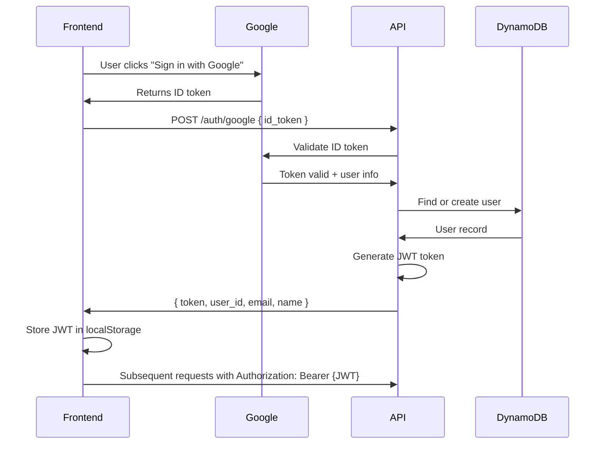

# Google OAuth Setup Guide

Esta guía explica cómo configurar Google OAuth para tu API de GymTracker **completamente gratis**.

## 📋 Resumen

- ✅ **100% Gratis** - No genera costos adicionales
- ✅ Simple de configurar
- ✅ Usa tu infraestructura actual (DynamoDB existente)
- ✅ Genera JWT tokens propios para tu API

## 🔧 Pasos de Configuración

### 1. Crear Proyecto en Google Cloud Console

1. Ve a [Google Cloud Console](https://console.cloud.google.com/)
2. Crea un nuevo proyecto (o usa uno existente)
3. **No necesitas habilitar billing** - OAuth es gratis

### 2. Configurar OAuth Consent Screen

1. Ve a "APIs & Services" > "OAuth consent screen"
2. Selecciona "External" (para que cualquier usuario con cuenta de Google pueda usar)
3. Completa la información básica:
   - **App name**: GymTracker
   - **User support email**: tu email
   - **Developer contact email**: tu email
4. Click "Save and Continue"
5. En "Scopes", agrega:
   - `openid`
   - `email`
   - `profile`
6. Click "Save and Continue"
7. En "Test users", puedes agregar emails de prueba (opcional en modo desarrollo)

### 3. Crear OAuth 2.0 Client ID

1. Ve a "APIs & Services" > "Credentials"
2. Click "Create Credentials" > "OAuth client ID"
3. Selecciona "Web application"
4. Configura:
   - **Name**: GymTracker Web Client
   - **Authorized JavaScript origins**:
     - `http://localhost:5173` (para desarrollo local)
     - `https://tu-dominio.com` (para producción)
   - **Authorized redirect URIs**:
     - `http://localhost:5173` (para desarrollo local)
     - `https://tu-dominio.com` (para producción)
5. Click "Create"
6. **Copia el Client ID** - lo necesitarás para configurar AWS

### 4. Instalar Dependencias de Go

```bash
go get google.golang.org/api/idtoken
go mod tidy
```

### 5. Configurar Secreto de Google en AWS SSM

Guarda tu Google Client ID en AWS Systems Manager Parameter Store:

```bash
aws ssm put-parameter \
  --name "/gym-tracker/google-client-id" \
  --value "TU_GOOGLE_CLIENT_ID_AQUI.apps.googleusercontent.com" \
  --type "String" \
  --overwrite \
  --region us-east-1
```

### 6. Desplegar la Infraestructura

```bash
# Build y deploy
make build
make deploy
```

Esto creará:
- ✅ Lambda function `gym-tracker-google-auth`
- ✅ API Gateway endpoint `POST /auth/google`
- ✅ GSI2 en DynamoDB para lookup por Google ID

## 🌐 Cómo Usar en el Frontend

### 1. Instalar Google Sign-In SDK

```bash
npm install @react-oauth/google
```

### 2. Configurar el Provider

```tsx
import { GoogleOAuthProvider } from '@react-oauth/google';

function App() {
  return (
    <GoogleOAuthProvider clientId="TU_GOOGLE_CLIENT_ID">
      {/* Tu app */}
    </GoogleOAuthProvider>
  );
}
```

### 3. Implementar el Botón de Login

```tsx
import { GoogleLogin } from '@react-oauth/google';

function LoginPage() {
  const handleGoogleSuccess = async (credentialResponse) => {
    // El ID token viene en credentialResponse.credential
    const response = await fetch('https://tu-api.execute-api.us-east-1.amazonaws.com/v1/auth/google', {
      method: 'POST',
      headers: { 'Content-Type': 'application/json' },
      body: JSON.stringify({
        id_token: credentialResponse.credential
      })
    });

    const data = await response.json();
    // data.token es tu JWT para usar en requests subsecuentes
    // data.user_id, data.email, data.name

    localStorage.setItem('token', data.token);
  };

  return (
    <GoogleLogin
      onSuccess={handleGoogleSuccess}
      onError={() => console.log('Login Failed')}
    />
  );
}
```

## 📊 Flujo de Autenticación



## 🔐 Request/Response Examples

### Request
```bash
POST /v1/auth/google
Content-Type: application/json

{
  "id_token": "eyJhbGciOiJSUzI1NiIsImtpZCI6IjY5Y..."
}
```

### Success Response (200)
```json
{
  "user_id": "550e8400-e29b-41d4-a716-446655440000",
  "email": "usuario@gmail.com",
  "name": "Juan Pérez",
  "token": "eyJhbGciOiJIUzI1NiIsInR5cCI6IkpXVCJ9..."
}
```

### Error Response (401)
```json
{
  "error": "invalid or expired Google token"
}
```

## 💰 Costos

| Servicio | Costo |
|----------|-------|
| Google OAuth | **$0** - Completamente gratis |
| Lambda | Incluido en free tier (1M requests/mes gratis) |
| API Gateway | Incluido en free tier (1M requests/mes gratis) |
| DynamoDB | Gratis hasta 25GB + 25 WCU/RCU |
| **Total** | **$0** (dentro de free tier) |

## 🔍 Troubleshooting

### Error: "invalid or expired Google token"
- Verifica que el Client ID en SSM sea correcto
- Verifica que el token no haya expirado (son válidos por ~1 hora)
- Asegúrate de que el origin del frontend esté en "Authorized JavaScript origins"

### Error: "GOOGLE_CLIENT_ID environment variable is required"
- Ejecuta el comando de SSM parameter del paso 5
- Redeploy el Lambda

### Usuario se crea pero no puede hacer login después
- Verifica que GSI2 esté creado en DynamoDB
- Verifica que el campo `google_id` se esté guardando correctamente

## 📚 Referencias

- [Google Identity Documentation](https://developers.google.com/identity)
- [@react-oauth/google](https://www.npmjs.com/package/@react-oauth/google)
- [JWT.io](https://jwt.io/) - Para debuggear tokens JWT
